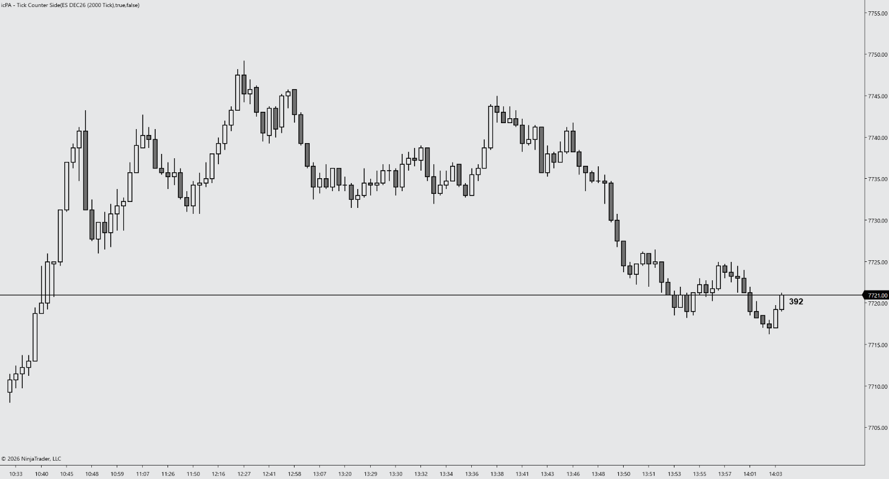

# icPA - Tick Counter Side for NinjaTrader 8

A specialized Indicator engineered for Price Action day trading. It shows the live tick count of the forming bar right beside it, riding on an optional horizontal line at the last traded price, with an optional bracket size label you define yourself, so you never have to look away from price to the corner of the chart.

---

## 📺 Video Walkthrough & Setup

Watch the complete breakdown of parameters, price action context, and chart examples on YouTube:

> **[▶ Click here to watch the full YouTube walkthrough](https://youtube.com/@icPriceAction)**

---

## ☕ Support the Project

All tools by **icPriceAction** are **100% free and open-source for personal trading use**. There are no paywalls, subscriptions, or locked features and there never will be!

Developing, optimizing for zero latency on multiple charts/instruments, and maintaining documentation and releases takes a **considerable amount of personal time and ongoing effort**. 

If this tool saves you screen time, improves your execution, or cleans up your charts, buying a coffee is the best way to support continued development:

  

> **[☕ Support Development on Buy Me a Coffee](https://buymeacoffee.com/icpriceaction)**

---

## 🆕 What's New in v1.4.0

- **Configurable bracket size label:** optionally append a label such as `[B1]` to the counter, based on the bar's size. Choose how the bar is measured (True Range, High - Low or Body), which bar (forming or last closed), the units (ticks or points), up to 5 size slots with your own labels, an overflow label and the label format. Off by default.
- **Counter above the price line by default:** the default Vertical Pixel Offset is now +16 (was -16). Positive values move the text up, negative values move it down.
- **Updated description** in the NT8 settings window, with support and prop firm links.

---

## ⚡ Key Features

- **Counter Beside the Bar:** Displays ticks remaining (count down), ticks elapsed, or percent complete next to the current bar, moving with the last traded price.
- **Configurable Bracket Size Label:** Classify the forming or last closed bar into up to 5 user-defined size brackets (in ticks or points) and show the matching label next to the counter. Works for any instrument or bracket system.
- **Infinite Price Line:** Optional horizontal line at the last price, with configurable width, dash style and color.
- **PATS & Context Aligned:** Designed for Price Action principles and disciplined futures execution.
- **Zero Chart Lag:** Native C# execution optimized to prevent UI freezes on high-frequency tick charts.
- **Clean Visuals:** Complementary default palette that preserves candlestick clarity without chart clutter.
- **Fully Customizable:** Configure colors, thresholds, offsets, and alerts via the native NT8 settings panel.

---

## ⚠️ Prerequisites & Data Requirements

- **Bar type:** Tick-based charts only: **Tick**, or **Heiken Ashi**, **Price on Volume** or **Volumetric** built on Tick. On other bar types the indicator shows NinjaTrader's standard "tick-based bars only" message and prints one warning to the Output window.
- **Calculate mode:** **On Each Tick** (the default). If set to On Bar Close, the counter will not update live and a one-time warning is printed to the Output window.

---

## 📥 Installation Guide

1. Head to the **[Releases](https://github.com/icPriceAction/tick-counter-side/releases)** tab of this repository.
2. Download the latest release `.zip` file.
   - *Note: Do NOT extract or unzip the file.*
3. Open **NinjaTrader 8**.
4. In the Control Center, navigate to:
   `Tools` ➔ `Import` ➔ `NinjaScript Add-On...`
5. Select the downloaded `.zip` file and click **Open**.
6. A success dialog will appear confirming the tool has been imported.
7. Open any chart, press `Ctrl + I`, find **icPA - Tick Counter Side** in the **icPA** folder, and add it.

---

## ⚙️ Parameters & Configuration

| Parameter | Group | Type | Default | Description |
| :--- | :--- | :--- | :--- | :--- |
| Count Down | 1. General | Boolean | True | Show ticks remaining in the bar instead of ticks elapsed. |
| Show Percent | 1. General | Boolean | False | Show the bar's progress as a percentage instead of a tick count. |
| Show Prefix Label | 1. General | Boolean | False | Show the "Tick count" / "Ticks remaining" label before the number. |
| Show Price Line | 2. Visuals | Boolean | True | Show an infinite horizontal line at the last traded price. |
| Line Width | 2. Visuals | Integer (1–20) | 2 | Thickness in pixels of the price line. |
| Line Style | 2. Visuals | Dash style | Solid | Dash style of the price line. |
| Line Color | 2. Visuals | Color | Black | Color of the price line. |
| Font | 2. Visuals | Font | Arial, 16, Bold | Font family, size and weight of the counter text. |
| Text Color | 2. Visuals | Color | Black | Color of the counter text. |
| Bars Right Offset | 3. Offsets & Thresholds | Integer (0–30) | 1 | Horizontal spacing in bars to the right of the current bar. |
| Vertical Pixel Offset | 3. Offsets & Thresholds | Integer (-100–100) | 16 | Pixel offset of the text relative to the price line (positive values shift it upward, negative values downward). |
| Show Bracket Size | 4. Bracket Size | Boolean | False | Append a bracket label (e.g. `[B1]`) to the counter based on the measured bar size and the slots below. |
| Bracket Source | 4. Bracket Size | Choice | True Range | How the bar is measured: **True Range** (includes gaps from the previous close, same as ATR(1)), **High - Low**, or **Body** (Open to Close). |
| Measure Bar | 4. Bracket Size | Choice | Forming Bar | **Forming Bar** (updates live) or **Last Closed Bar** (fixed while the current bar forms). |
| Units | 4. Bracket Size | Choice | Ticks | Units for the slot Max Size values: **Ticks** or **Points**. Values are not converted when you switch units. |
| Slot 1 Max Size | 4. Bracket Size | Number (0+) | 8 | Bars smaller than this size get the Slot 1 label. 0 = slot unused. |
| Slot 1 Label | 4. Bracket Size | Text | B1 | Label shown for Slot 1. |
| Slot 2 Max Size | 4. Bracket Size | Number (0+) | 12 | Bars smaller than this size (and not in an earlier slot) get the Slot 2 label. 0 = slot unused. |
| Slot 2 Label | 4. Bracket Size | Text | B2 | Label shown for Slot 2. |
| Slot 3 Max Size | 4. Bracket Size | Number (0+) | 16 | Bars smaller than this size (and not in an earlier slot) get the Slot 3 label. 0 = slot unused. |
| Slot 3 Label | 4. Bracket Size | Text | B3 | Label shown for Slot 3. |
| Slot 4 Max Size | 4. Bracket Size | Number (0+) | 0 | Bars smaller than this size (and not in an earlier slot) get the Slot 4 label. 0 = slot unused. |
| Slot 4 Label | 4. Bracket Size | Text | *(empty)* | Label shown for Slot 4. |
| Slot 5 Max Size | 4. Bracket Size | Number (0+) | 0 | Bars smaller than this size (and not in an earlier slot) get the Slot 5 label. 0 = slot unused. |
| Slot 5 Label | 4. Bracket Size | Text | *(empty)* | Label shown for Slot 5. |
| Overflow Label | 4. Bracket Size | Text | NB | Label shown when the bar is at least as large as every used slot. Leave empty to show nothing. |
| Label Format | 4. Bracket Size | Text | `[{0}]` | How the label is wrapped; `{0}` is replaced by the label. A space is always added before it. |

### 📏 How the bracket slots work

Slots are checked in order, 1 to 5. The bar gets the label of the **first slot whose Max Size is larger than the bar's size** (the Max Size itself is not included). Unused slots (0) are skipped, and anything at least as large as every used slot gets the Overflow Label. Keep the Max Size values in increasing order; if they are not, a one-time warning is printed to the Output window.

Bar sizes are rounded to whole ticks before comparing, so a bar is never put in the wrong bracket by floating-point rounding.

**Example: the default ES setup** (Units = Ticks, ES tick size 0.25):

| Bar size | Label |
| :--- | :--- |
| 0–7 ticks (under 2.00 pts) | `[B1]` |
| 8–11 ticks (2.00–2.75 pts) | `[B2]` |
| 12–15 ticks (3.00–3.75 pts) | `[B3]` |
| 16+ ticks (4.00+ pts) | `[NB]` |

These defaults are tuned for ES/MES. On other instruments, set the slots to your own bracket sizes before turning the label on.

---

## 📝 Changelog

- **v1.4.0**
  - Added a configurable bracket size label: source (True Range / High-Low / Body), forming or last closed bar, ticks or points, 5 slots, overflow label and label format. Off by default; no ATR indicator needed.
  - Default Vertical Pixel Offset changed from -16 to +16 (counter above the price line); corrected the setting's description of the offset direction.
  - Updated the indicator description with support and prop firm links.
- **previous versions** 
  - Initial public release. Cleaned and optimized by icPriceAction.
  - Removed the hard-coded ATR(1) bracket size label and its parameter.
  - Moved to the icPA folder and renamed the class to `icPATickCounterSide`.
  - Bar-type check cached once; price line and text redrawn only when they change.
  - One-time Output window warnings for non-tick charts and On Bar Close mode.

---

## 🐛 Bug Reports & Feature Requests

Found an issue or have an enhancement idea?
Please submit an issue on the [Issues tab](https://github.com/icPriceAction/tick-counter-side/issues).

---

## License

This indicator is based on the **TickCounter** indicator included with NinjaTrader 8. Portions are Copyright © NinjaTrader, LLC and remain subject to NinjaTrader's own license terms. Modifications are Copyright © 2026 Istvan Cebrian / icPriceAction.

Free for personal, non-commercial trading use on NinjaTrader 8. Commercial resale or distribution is prohibited, and modified versions may not be redistributed publicly without written consent from icPriceAction. See [LICENSE](LICENSE).

---

## ⚖️ Disclaimer

Futures trading involves substantial risk of loss and is not suitable for every investor. All indicators, drawing tools, strategies, and documentation provided by **icPriceAction** are for educational and analytical purposes only. Nothing herein constitutes financial or investment advice. Automated strategies can lose money and may behave differently in live markets than in simulation or backtests.

NinjaTrader® is a registered trademark of NinjaTrader, LLC. icPriceAction is an independent developer with no official affiliation to NinjaTrader, LLC.